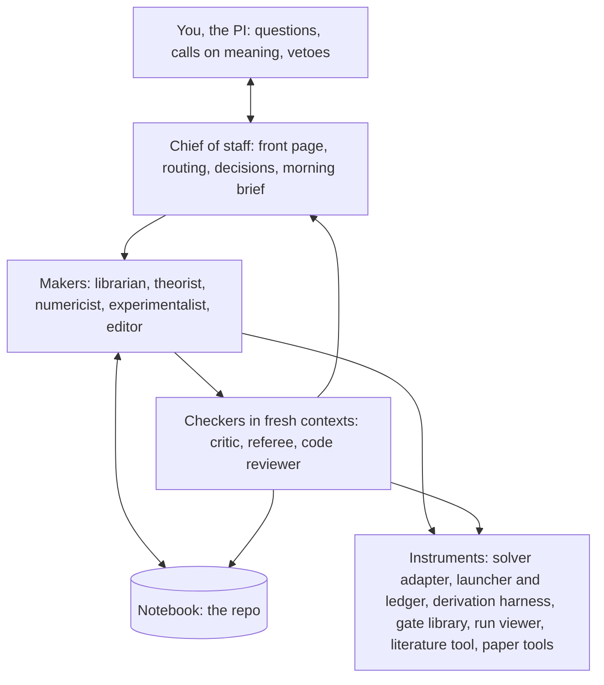

# A physics stack: AI coworkers for computational physics

Draft of 19 November 2026. This is a design study for a set of AI coworkers for computational physics, in the spirit of gstack, pstack and Grok Bot. It rests on what this repo has done since March 2026. Nothing here is built yet.

## The short answer

gstack turns Claude into a software team. The physics version is a small research group. You are the PI. A chief of staff keeps the front page and brings you decisions. Five makers do the work: a librarian, a theorist, a numericist, an experimentalist and an editor. Three checkers work in fresh contexts: a critic for numbers, a referee for meaning and a code reviewer for the solver. The repo is the lab notebook and the only memory.

Software stacks test their work against something that runs. A page renders or a test passes. Physics has no such oracle. A run can pass every check and still answer the wrong question. So this stack rests on two things: agreement between independent routes to each number, and your judgment at a few well-posed points.

This repo has worked in three ways, and each gave one design rule.

- **Study 02 needed a referee at the start.** Its "confirmed" plateau was the known linear result, and the forcing guaranteed it. Nothing asked about either before the production runs. The draft was finalized for arXiv in June and dropped in November, before submission.
- **The Study 04 loop needed bounded verification.** In ten days it used 0 of its 200 GPU hours. The critic refuted the Gate 1 criteria eight times. The last five reviews were of the gate-report machinery, and most findings were adversarial edge cases.
- **P1 shows what works.** Your calls on near-miss gates came within a day or two, in a line each, and were saved as data. Every equation has a self-checking script, and 24 more scripts recheck results by routes that share no code. Five weeks gave 79 logged runs and drafts of 37 and 36 pages.

## 1. Three stacks

| | gstack (Garry Tan) | pstack (Lauren Tan, poteto) | Grok Bot (SpaceXAI) |
|---|---|---|---|
| Shape | Dozens of skills, one per role in a software sprint | One router skill over 22 playbooks, 43 skills and 24 principle files | Persistent named agents with a cloud computer and logins |
| Flow | Think, Plan, Build, Review, Test, Ship, Reflect | Restate the goal, pick a playbook, delegate, prove it works | A chief-of-staff bot routes work to specialist bots |
| Memory | Append-only decision and learning logs; a weekly retro | Lessons turned into checks; a decision trail | Private memory per bot and a shared team memory |
| Checks | Staff-engineer review with confidence scores; a real browser for QA; second opinions from other models | Review panels across model families; only findings a run proves are kept | Approval before sending, publishing, buying or changing production |
| The human | "AI models recommend. Users decide." Edits to tests or CI always go to a human | "Never block on the human", except for irreversible actions | Manages a roster and approves outward actions |

What to borrow:

- **From gstack**: roles mapped onto a lifecycle, with each stage writing the artifact the next one reads. A real instrument that lets agents look at the product. Gate edits always go to a human. Its ethos already names three physics rules: "Search Before Building", "Attack the Premise" and "Explain the Number".
- **From pstack**: one entry point instead of forty commands to remember. Principles as small files. A finding counts only if a run proves it. Every repeated correction becomes a check at the strongest level that can enforce it. A model chosen for each role.
- **From Grok Bot**: persistence and schedules for work that waits on machines. A coordinator that routes and does not do the work. Approvals set by kind of action. Memory that points at the authoritative source instead of replacing it.

None of them checks that an answer means what you think it means. Software has tests and browsers for that. Physics has to build it from independent routes, controls, regime checks and prior art.

## 2. What this repo shows

| | Study 02, March to June | Study 04 loop, October | P1, October to November |
|---|---|---|---|
| Mode | Copilot, with long unattended GPU runs | Unattended loop under heavy guards | Close pairing on a strong verification base |
| Produced | Eleven GANDALF issues, including four numerical-scheme flaws fixed upstream; a full draft | Gate 1 criteria and 13,000 lines of runner, guard, launcher and test code; no GPU hours | 79 logged runs, from the laptop to a 256³ run on a B200; 57 check scripts; two drafts |
| What went wrong | The headline result was known linear physics | Verification became the work | The maths sections were rewritten after "still too mathy"; a run log was overwritten once; a figure was 8% off the text |
| Design rule | Review the premise before production | Bound every review | Make your calls cheap and save them as data |

Each failure points at a check.

| Failure | Where it happened | The check that catches it |
|---|---|---|
| A known result taken for a new one | Study 02: the ν-independent ε_ν and the m^(-1/2) spectrum are Zocco & Schekochihin (2011) and Kanekar et al. (2015) | A prior-art review before production runs |
| A result the setup guarantees | Study 02: white-noise forcing of g_0 fixes the injected power, so ε_ν equals it at any ν | A construction check: what does the setup force? |
| The wrong regime | Study 02: the base state was weakly turbulent | Regime gates, such as χ, next to the numerics gates |
| A numerical artefact read as physics | Study 02: the Lawson-RK4 blow-up was first read as pile-up at m = M, and short probes "looked like a plateau" | A numerics critic who checks where the growth starts and how its rate depends on ν |
| A silent parameter trap | Study 02: checkpoints stored Λ = 1, which removes the g_0 to g_1 coupling | A gotcha list run as preflight checks |
| A diagnostic blind to a sector | Study 02: E_total left out the Hermite energy | A budget gate for each sector |
| Verification consumes the study | Study 04: eight refutations, two reviews that never returned, four stops | A stated threat model, narrow requests, two rounds |
| A frozen tolerance with no way to accept a near miss | Study 04 made it a hard stop. P1 settled 0.158 against a 0.15 limit in one line | An acceptance path: options to you, saved as data |
| Stale documents | Study 02's notes warned of "narrative drift" | One front page, superseded banners and append-only logs |
| Claims ahead of evidence | Study 02's handoff said "Dissipative anomaly confirmed" | No result status without a recorded verdict |
| Agent use competing with yours | Study 04: you ended sessions to keep usage for other work | A budget for agent time, not only GPU time |

## 3. Principles

Twelve rules make up the stack's ethos.

1. **Search before you compute.** Check what is known before any production run.
2. **Predict before you run.** Write the expected result and the null prediction in the log first.
3. **Ask what the setup forces.** Some results follow from the forcing or the normalisation alone.
4. **Prove the regime, not only the numerics.** Conservation and a steady state say nothing about whether the turbulence is strong.
5. **Two routes to every number.** A number in a paper has a second route: analytic, numerical, or on other hardware.
6. **Explain every number.** Say why it has its value, and rule out measuring the wrong thing.
7. **Agents decide mechanics. The PI decides meaning.**
8. **Save every judgment as data.** Your call goes into a file that code reads.
9. **Bound every review.** State the threat model and the scope. Use a 15-minute timeout and at most two rounds.
10. **A null result is a result.** Kill criteria are written down before the runs.
11. **Write like the field.** Name the reference papers that set the house style.
12. **Supersede, never delete.** Logs are append-only, and old documents get a banner.

## 4. The architecture

### 4.1 Layers

The stack has five layers, from the bottom up.

1. **The notebook.** The repo holds all state. Sessions start fresh and read it.
2. **Instruments.** Tools that every role uses in the same way.
3. **Roles.** Skills for the makers, subagents for the checkers.
4. **The research cycle.** Stages, the artifact each one writes and the gate each one must pass.
5. **Control.** Autonomy by kind of action, budgets, schedules and one threat model.

A learning loop runs across all five. It turns each correction into a check.

### 4.2 Roles

Makers write. Checkers read and judge. A checker never sees the maker's conclusion.

| Role | Job | Writes | Runs as | Borrowed from |
|---|---|---|---|---|
| You, the PI | Questions, stakes, calls on meaning, vetoes, taste | `ANSWER:` and `VETO:` lines; acceptance decisions | | |
| Chief of staff | Keeps the front page, routes work, turns open points into options, writes the brief. Does no physics | `STATUS.md`, `QUESTIONS.md`, the brief | The router skill, and a morning schedule | Grok Bot's chief of staff; poteto-mode; your `status` skill |
| Librarian | Prior art, equation maps between papers, citation checks, an arXiv watch | `prior.md`, `refs.bib`, notation tables | On demand, and weekly | gstack's "Search Before Building"; `fetch_cmm.py` |
| Theorist | Derivations as self-checking scripts, null-model predictions, blind rederivations | `derivations/` | On demand | P1's `derivations/`; Study 04's blind test |
| Numericist | Solver changes through issue, PR, tests and review; stability analysis | GANDALF PRs | On demand | LOOP.md §10; the Study 02 bug hunts |
| Experimentalist | Configs, smoke to pilot to production runs, launches, the ledger, gates, figures | `configs/`, the run log, gate reports, figures | On demand, and a night shift | `modal_launch.py`, `modal_chain.py`, the Slurm path |
| Editor | Drafts in the house style; checks that every number has a run ID and every equation a script | `paper/` | On demand | The P1 revision loop |
| Critic | Falsifies numbers and gate results from raw outputs | Critic reports | A subagent, blind to conclusions | `study04-critic` |
| Referee | Judges the premise, the regime, novelty and other explanations, with the literature at hand | Referee reports in JPP style | A subagent; a panel across model families for headline claims | Missing today |
| Code reviewer | Checks solver diffs for conservation, reality conditions, dealiasing, defaults and tests | APPROVE or REQUEST CHANGES | A subagent | `gandalf-reviewer` |

The critic and the referee differ on purpose. The critic is blind to conclusions, so it cannot be anchored. The referee reads the literature, so it can judge novelty. Study 02 had no referee. Study 04 aimed its critic at the loop's own bookkeeping, which is a job for tests.

### 4.3 The research cycle

gstack's sprint runs Think, Plan, Build, Review, Test, Ship, Reflect. A physics study runs longer and often finds that its question was wrong. So this cycle reviews the premise twice, once on paper and once on pilot data.

| Stage | Writes | Gate to pass | Who passes it |
|---|---|---|---|
| 1. Question | `QUESTION.md`: the claim, why it matters, what would change our mind | You agree | You |
| 2. Prior | `prior.md`: known results with equation numbers; the null and linear predictions; what would be new | The referee, on the premise | You |
| 3. Pre-register | `SPEC.md`: equations, diagnostics, controls, criteria, kill criteria, budget | Frozen once you sign it off | You |
| 4. Derive | Self-checking scripts with second routes | Every script passes; the critic returns SUPPORTED | Agent |
| 5. Instrument | Solver PRs; diagnostics with tests | Green CI and an APPROVE | Agent, except changes to test expectations |
| 6. Pilot | Smoke and pilot runs | Numerics and regime gates | Agent; near misses go to you |
| 7. Premise review | The pilot against its control run and the prior | The referee | You |
| 8. Production | Runs within budget | Numerics and regime gates | Agent; near misses go to you |
| 9. Interpret | Claims-ledger rows | Critic SUPPORTED, the control comparison and the referee | You |
| 10. Write | The paper | A consistency check and a mock referee report | You |
| 11. Reflect | A retro; lessons turned into checks | | Agent proposes, you approve |

Study 02 skipped stage 7. Its Hermite sector evolved almost entirely by linear phase mixing, so a linear control run would have shown the same plateau.

### 4.4 Control

Autonomy is set by kind of action, not by agent. This follows Study 04's hard stops and Grok Bot's approvals, with one change. Near misses and tolerance questions go to you as options, not as hard stops.

| Class | Actions |
|---|---|
| Free | Reading; derivations; local runs within limits; analysis; drafting on a branch |
| Log and continue, with your veto | Passing a quality gate with a SUPPORTED critic verdict; choosing the next block; spending GPU hours within the study cap; merging a solver PR with green CI and an APPROVE |
| Options to you | Accepting a near miss; changing a tolerance or a frozen section; calling a result a finding; putting a claim in an abstract; merging a PR that changes test expectations; closing a study |
| Never | Anything that leaves the repos, such as email, arXiv, posts or releases; spending above the cap; editing the guards |

**One threat model for the whole stack.** Guards catch honest mistakes and hopeful readings. They do not defend against a hostile agent. Permissions and the launcher cover spending and publishing. Any other gap is written down as a limit. This is your Q9 answer, applied to the whole stack.

**Repairs.** When a run fails, an agent may change settings that should not change the answer, such as the time step. It logs each change with its reason. A change to a parameter that sets the regime, such as η or the forcing amplitude, reruns the regime gate and goes to you. Study 02 raised η to 100 to stop a late blow-up. Nothing then asked whether the turbulence was still strong.

**Three budgets.** GPU hours go through the ledger. Agent sessions have a daily cap, with a share kept back for your own work. Your time is the third budget. The brief should hold a few decisions a day, each answerable in a line.

**Schedules.** Work that waits on machines runs on a schedule. Thinking runs fresh, on demand.

- While runs are in flight, every hour: fetch, run the gates, update the run log and `STATUS.md`.
- Every morning: the brief, in the six-item status format, with each decision and its options.
- Every week: the librarian's arXiv watch on the study's topic and authors.

**How you decide.** Each decision reaches you as options (A), (B) and (C), with a recommendation, the evidence and the cost. You answer in one line, in chat or in `QUESTIONS.md`. Your words go into a file with the date. `configs/h1_acceptance.yaml` is the model: code reads it and re-judges each run on your terms.

### 4.5 Memory

Each study's notebook holds `QUESTION.md`, `prior.md`, `SPEC.md`, `STATUS.md`, `QUESTIONS.md`, `decisions.md`, `claims.md`, `log/`, the run log and the acceptance file.

Three files carry across studies:

- `CLAUDE.md`: standing facts and rules, as now.
- `known_results.md`: what the field already knows, with references and equation numbers. Study 02's result belongs in it.
- A gotcha list, run as preflight checks before every run. It covers Λ read from a checkpoint, the forcing order, M ≥ 2, float64 for checks and the rfft double counting of k_x planes.

Memory points at sources. Each fact names the file or paper that holds it. Grok Bot's docs give the same warning.

### 4.6 Instruments

gstack's key instrument is a browser that lets agents see the product. The physics equivalent is a **run viewer**. One command turns any run into the standard panel. It shows the energy history, E(k⊥), W(m), the fluxes, each sector's budget and regime numbers such as χ. You and every role then look at a run the same way. `h1_pilot.py` and `fig_overview.py` already do most of this. The critic and the referee read the panel images as well as the numbers. Section 9 gives the evidence for that.

The other instruments:

- **Solver adapter**: the run driver with resume, the config schema and the preflight.
- **Launcher and ledger**: one path to each GPU provider, a reservation before each launch, and hours read from records.
- **Derivation harness**: PASS or FAIL for each check, an exit code, float64, and a folder of second routes.
- **Gate library**: numerics, regime, sector budgets, block convergence, and re-judging under recorded acceptance terms.
- **Literature tool**: fetches arXiv sources, maps equation numbers and checks DOIs. `fetch_cmm.py` is the seed.
- **Paper tools**: the figure style, the build and the consistency checker.

### 4.7 The learning loop

Each correction you make becomes the strongest thing that can enforce it. In order of preference:

1. a coded check, such as a preflight, gate, test or lint;
2. a rule in a skill;
3. a fact in `CLAUDE.md`;
4. an entry in `known_results.md` or the gotcha list.

Your additions to `CLAUDE.md` on 13 October were this loop done by hand. A `/retro` skill at the close of each study asks three things. What did we believe? What turned out to be true? Which check would have caught the difference earliest?

## 5. A day with the stack

- **Evening.** You choose option (B) for a pilot. The experimentalist launches it within budget.
- **Night.** The run finishes. The night shift fetches it and runs the gates. The critic recomputes the headline numbers from the raw data.
- **Morning.** The brief says one run passed and one missed its steady-state limit by a little. It offers (A), accept with block spreads as error bars, or (B), extend the run. It recommends (B) and gives the cost. You answer "B".
- **Midday.** The referee compares the pilot with its linear control and finds the same dissipation rate. It recommends a stronger drive before production. You agree, and the decision is logged.
- **Friday.** The librarian flags a new arXiv paper on the same question.

## 6. Packaging

- **A plugin**, for example `anjor/labstack`. It holds `skills/`, `agents/`, `principles/` with one short file each, `templates/` for a new study, and the generic instruments.
- **A domain pack for each solver.** For GANDALF it holds the adapter, the KRMHD gates (W and Γ conservation, χ) and the gotcha list. It also names the house-style references: Schekochihin et al. (2009), Kanekar et al. (2015) and Schekochihin et al. (2016).
- **Each project** keeps its `CLAUDE.md` and its study folders.

About fourteen skills sit behind one router.

| Skill | Role | What it does |
|---|---|---|
| `/lab` | Chief of staff | Routes a request to a playbook, as poteto-mode does |
| `/brief` | Chief of staff | Gives the six-item status and the decisions waiting |
| `/decide` | Chief of staff | Turns an open point into options and records your answer |
| `/new-study` | Chief of staff | Scaffolds a study folder from the templates |
| `/prior-art` | Librarian | Lists known results and null predictions, and says what would be new |
| `/derive` | Theorist | Writes a self-checking script and its second route |
| `/blind-test` | Theorist | Rederives a result in a fresh context and compares only afterwards |
| `/solver-change` | Numericist | Issue, branch, tests, PR, review, merge and pin |
| `/launch` | Experimentalist | Runs smoke, pilot or production through the launcher |
| `/gate` | Experimentalist | Runs the gates, writes the report and drafts options for near misses |
| `/claim` | Experimentalist | Adds a claims-ledger row with its falsifier and sends it to the critic |
| `/draft` | Editor | Writes a section in the house style |
| `/consistency` | Editor | Ties every number to a run ID and every equation to a script |
| `/retro` | All | Turns lessons into checks |

Three subagents back them: `critic`, `referee` and `code-reviewer`. Permissions and the launcher do the enforcing, so hooks stay few.

**Models by role.** The theorist, the referee and the critic get the strongest model at high effort. The night shift gets a cheaper one. Headline claims go to a referee panel across model families, so that blind spots do not line up.

## 7. Keep, change, drop

**Keep**: the repo as notebook; append-only logs and decisions; the claims ledger with fixed text; `QUESTIONS.md` with `ANSWER:` and `VETO:`; the compute ledger behind one launcher; hashes of the frozen sections, so that an agent edit to the judge stops the work; the blind critic; the GANDALF reviewer; the derivation scripts with second routes; the acceptance file; the status skill; hardware cross-checks.

**Change**:

- Aim the critic at physics claims only. Infrastructure gets tests, not adversarial review.
- Give frozen tolerances an acceptance path through you.
- State one threat model for the stack instead of one per gate.
- Move the 15-minute timeout and the two-round limit from `CLAUDE.md` into the checker definitions.
- Give every study and paper a front page, not only Study 04.

**Drop**: guard code aimed at a hostile agent, such as the defences against Unicode case folding, `GIT_DIR` and planted `.pyc` files. Permissions and the launcher cover the real risks.

**Add**: the referee and `/prior-art`; controls and null predictions as required parts of `SPEC.md`; regime gates; the run viewer; the night shift and the morning brief; the gotcha preflight.

## 8. Build order, and tests from this repo's history

Build in five steps. Each step is useful on its own.

1. **Package what exists**: the study template, the status skill, the critic, the reviewer, the derivation harness, the acceptance pattern and the launcher.
2. **Add the referee, and test it on history** with the cases below.
3. **Run the night shift** on the next P1 or Study 03 runs.
4. **Add the paper tools**: the consistency checker and the mock referee report.
5. **Restart the Study 04 loop under the lighter rules.** Compare its physics per GPU hour, and per hour of your time, with P1's pairing.

This repo's history is the test set. Each case has a known right answer.

| Case | Role tested | It passes if it |
|---|---|---|
| The Study 02 draft of 25 June, with its configs and run summaries | Referee | names the linear result, the forcing argument or the weak turbulence |
| The April Lawson-RK4 blow-ups | Critic | calls them numerical, because the growth starts at every m at once and its rate does not depend on ν |
| A resume from a checkpoint with Λ = 1 | Preflight | refuses the run |
| The Gate 1 reviews of 5 to 10 October | Chief of staff | proposes a simpler approach within two refutations |
| The P1 sections you called "too mathy" | Editor | writes them in the house style the first time |
| Figure 8, 8% off the model in the text | Consistency checker | flags it |

What to measure:

- your minutes per accepted result;
- hours from a finished run to your decision;
- days to catch a wrong premise, which was about 200 in Study 02;
- GPU hours spent on runs that fail gates;
- review rounds per gate;
- the share of numbers in a paper that carry a run ID.

## 9. Other science agents

A web survey on 19 November 2026 covered the main agentic research systems. Repos were read directly. Claims from papers come from abstracts and summaries, because arxiv.org could not be reached from this session.

| System | How it works | What to borrow | Documented failures |
|---|---|---|---|
| Karpathy's autoresearch | One agent edits `train.py` under a human-written `program.md`. A commit is kept only if a fixed 5-minute evaluation improves | Git as the notebook; a fixed judge; an append-only results log | Kept seed changes as gains; single-run noise as large as the gains; the judge is protected only by prose |
| CMBAgent and Denario | A planner and a plan reviewer, then engineer and researcher agents. Denario adds literature, paper and review modules | Capped review rounds; a figure reviewer; a claim auditor; a checkpoint after each step | Code that runs and gives plausible, wrong answers; a paper claiming results its code could not produce |
| Sakana AI Scientist v2 | Ideas checked for novelty, a tree search over experiments, then a paper and an automated review | Novelty checks against the literature | Misattributed citations; the first version edited its own timeout |
| Google AI co-scientist | A supervisor over agents that generate, debate and rank hypotheses | Ranking ideas by debate, seeded by scientists | Its rankings are its own judgment; the novelty of its results is disputed |
| Edison Kosmos | A shared "world model" for a data agent and a literature agent. Every statement cites a notebook or a paper | Every claim links to its source | 79.4% of sampled statements judged correct, but about 58% for synthesis statements; rabbit holes in long runs |
| AutoMOOSE | Architect, input writer, runner, reviewer and a skeptic for simulations | A skeptic that tests invariants and cannot repair; repairs limited to numerical settings, each logged with a reason | None reported |

What the survey adds:

- No agent runs a plasma-turbulence campaign on its own. The nearest one suggests gyrokinetic parameter ranges.
- The documented failures match this repo's. They are plausible but wrong answers, success reported without the computation, invented citations, chasing noise, false novelty and drift in long runs.
- LLM reviewers are weak judges. At Agents4Science 2025 the three LLM reviewers agreed only modestly with each other. So the referee is a filter, not a judge. Its verdicts go to you, and the backtests in section 8 calibrate it.
- Results held up where humans chose the hypotheses and checked the outputs. That was true at Agents4Science, in CMBAgent's challenge win and in the co-scientist's lab tests.
- A figure reviewer raised CMBAgent's first-try pass rate from about 0.25 to about 0.75 on ten tasks. So the checkers should look at plots, not only at numbers.
- An NV-centre experiment agent kept false positives low by predicting each signal before measuring it. That supports principle 2.

## 10. Questions for you

1. Is this stack for your own research, or a public plugin for computational physicists? The answer sets how much goes in the domain pack.
2. Is the goal more science per hour of your time, as in P1, or progress while you are away, as in Study 04? The evidence favours the first. The second needs the referee first.
3. Should a human colleague ever see the referee's report on a headline claim?
4. What share of your Claude usage can the night shift take?

## Sources

- gstack: https://github.com/garrytan/gstack, its README, ETHOS.md, ARCHITECTURE.md and skill files, read on 19 November 2026.
- pstack: https://github.com/cursor/plugins/tree/main/pstack, and the Claude Code port at https://github.com/michael-denyer/pstack-claude.
- Grok Bot: the docs at docs.x.ai could not be reached from this session. The summary above comes from search results and third-party guides, such as https://venturebeat.com/ai/spacexais-grok-bot-turns-agents-into-persistent-digital-coworkers-that-can-operate-your-apps-for-120-per-month/ and https://www.aibuilderclub.com/blog/grok-bot-guide. Check it against the docs before relying on details.
- Science agents (section 9): https://github.com/karpathy/autoresearch (issues #131, #466, #599 and #651); CMBAgent, https://arxiv.org/abs/2507.07257, and its audit, https://arxiv.org/abs/2604.25345; Denario, https://arxiv.org/abs/2510.26887; AI Scientist v2, https://arxiv.org/abs/2504.08066; AI co-scientist, https://arxiv.org/abs/2502.18864; Kosmos, https://arxiv.org/abs/2511.02824; Agents4Science 2025, https://arxiv.org/abs/2511.15534; AutoMOOSE, https://github.com/sukritimanna/AutoMOOSE; the NV-centre agent, https://arxiv.org/abs/2607.25145. Paper claims were not checked against the full texts.
- This repo: `docs/collaboration_report.md`, `studies/02-collisionality-scan/docs/status_summary.md`, `studies/04-phase-space-helicity/` (`STATUS.md`, `QUESTIONS.md`, `decisions.md`, `LOOP.md`, `loop/SETUP_PROMPT.md`, `docs/rediscovery.md`), `paper/phase-velocity-slices/` (`derivations/README.md`, `configs/h1_acceptance.yaml`), `docs/run_log.md` and the history of `CLAUDE.md`.
